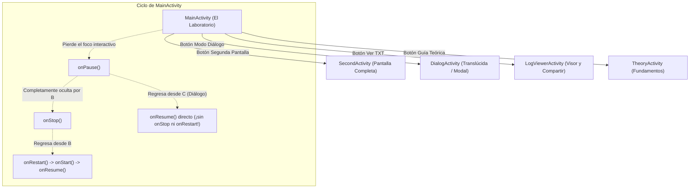
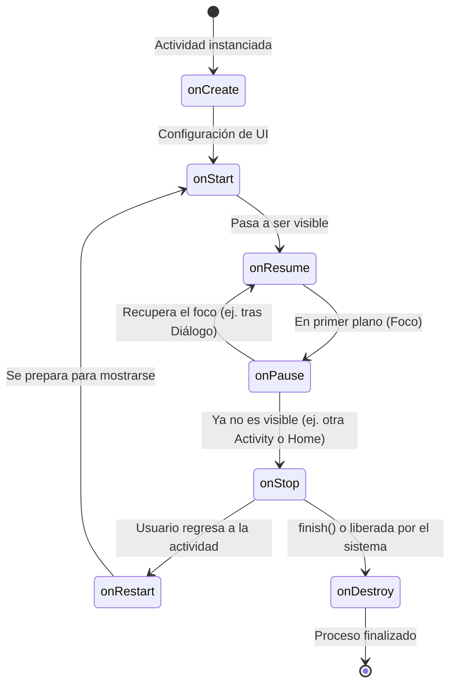

# 📱 Lifecycle Lab: Laboratorio del Ciclo de Vida en Android

Una aplicación educativa desarrollada con **Kotlin** y **Jetpack Compose**, diseñada específicamente para clases y cátedras de programación móvil en Android. Permite a los estudiantes experimentar, observar en vivo y analizar cómo el sistema operativo Android gestiona el ciclo de vida de los componentes.

---

## 🎯 Objetivos Pedagógicos

1. **Comprensión Práctica**: Pasar por **todos** los estados y métodos del ciclo de vida (`onCreate`, `onStart`, `onResume`, `onPause`, `onStop`, `onRestart`, `onDestroy`, `onSaveInstanceState`).
2. **Doble Registro (Memoria RAM + Disco)**:
   - **Vector en RAM**: Mantiene una colección en memoria (`Vector<LifecycleEntry>`) para alimentar la interfaz reactiva en tiempo real.
   - **Persistencia en TXT**: Cada evento se escribe de inmediato en `lifecycle_log.txt` en el almacenamiento interno privado de la aplicación (`context.filesDir`). De esta forma, **incluso si el proceso es finalizado por el sistema operativo o se cierra la aplicación**, el archivo TXT sobrevive y puede ser inspeccionado.
3. **Visor y Exportador Integrado**: La app cuenta con una pantalla dedicada para visualizar el archivo plano generado y exportarlo/compartirlo (vía `FileProvider`) por correo, Drive, WhatsApp, etc.
4. **Módulo Teórico Interactivo**: Incluye una guía con tarjetas de estudio sobre qué hacer y qué evitar en cada callback.

---

## 🏗️ Flujo y Arquitectura de Pantallas



---

## 🔄 El Ciclo de Vida de Android



---

## 🧪 Guía de Experimentos para la Clase

Los alumnos pueden realizar los siguientes experimentos prácticos para contrastar la teoría con el archivo `lifecycle_log.txt`:

### Experimento 1: Transición a pantalla completa vs Diálogo (¡Pregunta clásica de examen!)
1. Presiona **"Segunda Pantalla"**:
   - Observa en el log: `MainActivity.onPause()` $\rightarrow$ `SecondActivity.onCreate()` $\rightarrow$ `SecondActivity.onStart()` $\rightarrow$ `SecondActivity.onResume()` $\rightarrow$ `MainActivity.onStop()`.
   - Vuelve atrás con el botón de retroceso. Observa: `SecondActivity.onPause()` $\rightarrow$ `MainActivity.onRestart()` $\rightarrow$ `MainActivity.onStart()` $\rightarrow$ `MainActivity.onResume()` $\rightarrow$ `SecondActivity.onStop()` $\rightarrow$ `SecondActivity.onDestroy()`.
2. Ahora presiona **"Modo Diálogo"**:
   - La pantalla de diálogo es translúcida y no tapa por completo a `MainActivity`.
   - Observa en el log: `MainActivity` ejecuta **únicamente `onPause()`**, ¡**NO** ejecuta `onStop()`!
   - Al cerrar el diálogo, `MainActivity` pasa de inmediato a `onResume()`.

### Experimento 2: Cambio de configuración (Giro de pantalla o recreate)
1. Presiona el botón **"Recrear Pantalla"** o rota el emulador/teléfono físico.
2. Observa cómo la actividad se destruye y reconstruye para adaptarse a la nueva configuración:
   `onPause()` $\rightarrow$ `onStop()` $\rightarrow$ `onSaveInstanceState()` $\rightarrow$ `onDestroy()` $\rightarrow$ `onCreate()` $\rightarrow$ `onStart()` $\rightarrow$ `onRestoreInstanceState()` $\rightarrow$ `onResume()`.

### Experimento 3: Segundo plano (Home)
1. Presiona **"Minimizar (Home)"** o el botón circular de Android.
2. La app pasa a segundo plano (`onPause()` $\rightarrow$ `onStop()`).
3. Vuelve a abrir la app desde la lista de apps recientes.
4. Nota que no se ejecutó `onCreate()`, sino `onRestart()` $\rightarrow$ `onStart()` $\rightarrow$ `onResume()`.

### Experimento 4: Persistencia del archivo TXT tras el cierre
1. Presiona **"Cerrar (finish)"** o desliza la app fuera de la multitarea para matarla.
2. Vuelve a iniciar la app.
3. Ve a **"Ver TXT Persistente"**: Comprobarás que todos los eventos anteriores siguen registrados en el archivo con su timestamp exacto.

---

## 📁 Formato del Registro TXT (`lifecycle_log.txt`)

El archivo se almacena en `context.filesDir/lifecycle_log.txt`. Ejemplo de su contenido:

```text
====================================================================
        REGISTRO DE CICLOS DE VIDA DE ANDROID - LIFECYCLE LAB       
====================================================================
Formato: [FECHA Y HORA] [#EVENTO] [ACTIVIDAD] -> METODO() | EXPLICACION
====================================================================

[2026-10-19 21:15:02.140] [#1] [MainActivity] -> onCreate() [Primer inicio (savedInstanceState == null)] | La actividad se crea e inicializa su UI y estado.
[2026-10-19 21:15:02.185] [#2] [MainActivity] -> onStart() [La interfaz se hace visible] | La actividad se hace visible pero aún no interactuable.
[2026-10-19 21:15:02.190] [#3] [MainActivity] -> onResume() [Tiene el foco del usuario y es interactiva] | La actividad está en primer plano y lista para interactuar.
[2026-10-19 21:15:20.450] [#4] [MainActivity] -> onPause() [Pierde el foco interactivo] | Pierde el foco (puede seguir parcialmente visible, ej: diálogo).
[2026-10-19 21:15:20.480] [#5] [DialogActivity] -> onCreate() [Primer inicio (savedInstanceState == null)] | La actividad se crea e inicializa su UI y estado.
[2026-10-19 21:15:20.510] [#6] [DialogActivity] -> onStart() [La interfaz se hace visible] | La actividad se hace visible pero aún no interactuable.
[2026-10-19 21:15:20.525] [#7] [DialogActivity] -> onResume() [Tiene el foco del usuario y es interactiva] | La actividad está en primer plano y lista para interactuar.
[2026-10-19 21:15:28.120] [#8] [DialogActivity] -> onPause() [Pierde el foco interactivo] | Pierde el foco (puede seguir parcialmente visible, ej: diálogo).
[2026-10-19 21:15:28.140] [#9] [MainActivity] -> onResume() [Tiene el foco del usuario y es interactiva] | La actividad está en primer plano y lista para interactuar.
[2026-10-19 21:15:28.160] [#10] [DialogActivity] -> onStop() [Ya no es visible en pantalla] | Ya no es visible para el usuario (pasó a segundo plano u otra pantalla).
[2026-10-19 21:15:28.175] [#11] [DialogActivity] -> onDestroy() [Cerrada voluntariamente con finish()] | La actividad se destruye (por finish o recreación del sistema).
```

---

## 🛠️ Tecnologías y Librerías

- **Lenguaje**: [Kotlin 2.0.21](https://kotlinlang.org/)
- **UI Framework**: [Jetpack Compose](https://developer.android.com/jetpack/compose) con **Material Design 3**
- **Arquitectura**: Activities nativas comunicadas con `LifecycleTracker` reactivo (`StateFlow` + `Vector`)
- **Persistencia**: I/O concurrente a archivo plano local `.txt`
- **Compartir Archivos**: `androidx.core.content.FileProvider` (sin excepciones de seguridad `FileUriExposedException`)
- **Gradle**: Kotlin DSL (`build.gradle.kts`) con catálogo de versiones centralizado (`libs.versions.toml`)

---

## 🚀 Cómo abrir y compilar el proyecto en Android Studio

1. Clona este repositorio:
   ```bash
   git clone https://github.com/TU_USUARIO/TU_REPOSITORIO.git
   ```
2. Abre **Android Studio** (versión Ladybug / Jellyfish o superior).
3. Selecciona **File > Open...** y elige la carpeta del proyecto.
4. Espera a que termine la sincronización de Gradle (*Sync Project with Gradle Files*).
5. Selecciona un dispositivo virtual (AVD) o conecta un dispositivo físico por USB.
6. Presiona **Run** (`Shift + F10` o el botón verde de Play ▶️).

---

## 📄 Licencia

Este proyecto está disponible bajo la licencia MIT. Siéntete libre de utilizarlo, modificarlo y compartirlo con tus alumnos y colegas docentes.
